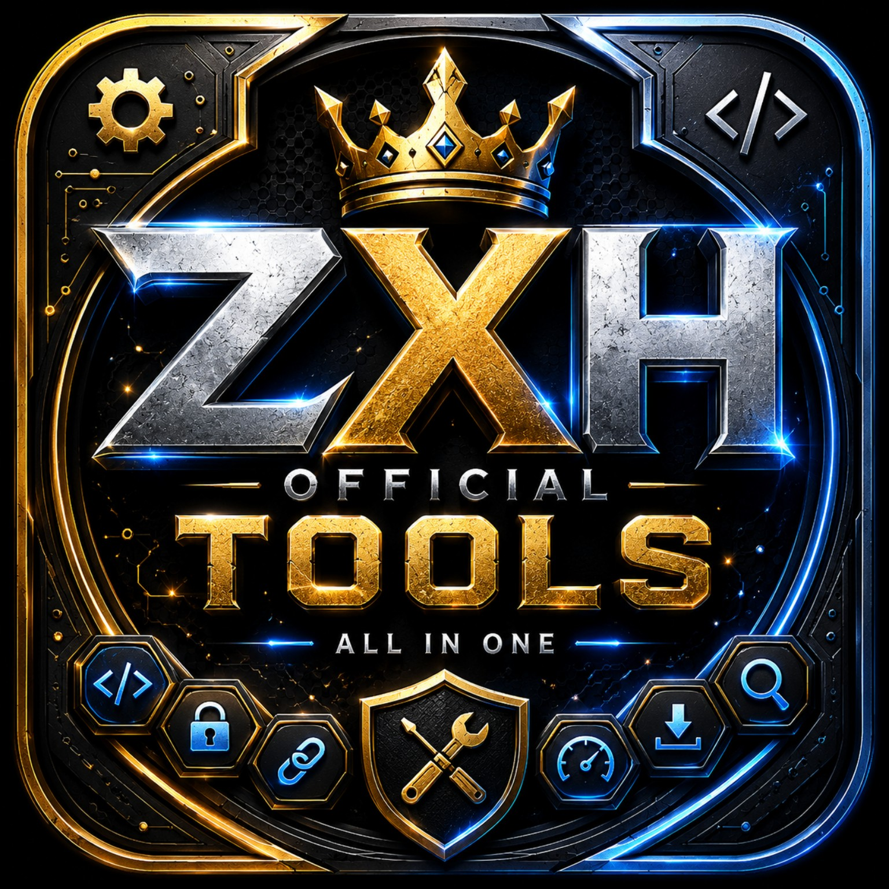

<div align="center">



# ZXH OFFICIAL TOOLKIT

### 100+ Free Online Tools • Next.js • React • TypeScript

**A complete, mobile-first tools hub by ZXH OFFICIAL**

[](https://github.com/zulqarnainhaider7116-art/ZXH-Official-Tools/actions/workflows/verify.yml)
[](https://nextjs.org/)
[](https://react.dev/)
[](https://www.typescriptlang.org/)
[](https://firebase.google.com/)
[](#license)

[🌐 Live Website](https://zxh-official-tools.pages.dev/) · [📦 Repository](https://github.com/zulqarnainhaider7116-art/ZXH-Official-Tools) · [👨‍💻 Developer](https://mr-zxh-official.vercel.app/)

</div>

---

## ✨ About

**ZXH OFFICIAL TOOLKIT** is an all-in-one, responsive online tools platform created and maintained by **ZULQARNAIN X HAIDER**. The latest codebase uses the Next.js App Router, React and TypeScript, with Firebase Realtime Database for live tool data and community activity.

The interface is designed for mobile and desktop users, with a colorful light-first visual system, responsive layouts and installable PWA support.

## 🚀 Technology

| Layer | Technology |
| --- | --- |
| Framework | Next.js 15 (App Router) |
| UI | React 19 |
| Language | TypeScript 5.9 |
| Styling | CSS (global design system) |
| Realtime data | Firebase Realtime Database |
| Web app | PWA manifest and install support |
| Quality checks | TypeScript compiler + Next.js production build |
| Automation | GitHub Actions |

## 🧰 Platform capabilities

- **Live tools catalogue** — tool records are read from Firebase Realtime Database.
- **Discovery** — search, category filtering and sorting.
- **Personalization** — favourites and saved theme preference in browser storage.
- **Community feedback** — tool ratings and reviews.
- **Activity insights** — site and tool view counters, daily statistics and recent activity tracking.
- **Notifications** — live notification feed from the database.
- **PWA support** — web app manifest, launcher icon and browser install flow.
- **Responsive interface** — optimized for mobile screens as well as desktop.
- **SEO and sharing metadata** — page metadata, canonical URL, Open Graph, Twitter cards and structured data.

> Tool availability and live catalogue content depend on the configured Firebase Realtime Database.

## 🖥️ Getting started

### Requirements

- Node.js 20 or newer
- npm
- Git

### Install dependencies

```bash
git clone https://github.com/zulqarnainhaider7116-art/ZXH-Official-Tools.git
cd ZXH-Official-Tools
npm install
```

### Run locally

```bash
npm run dev
```

Open [http://localhost:3000](http://localhost:3000).

### Available scripts

| Command | Purpose |
| --- | --- |
| `npm run dev` | Start the local development server |
| `npm run typecheck` | Run TypeScript checks |
| `npm run build` | Create the optimized production build |
| `npm run start` | Start the production server |

## 🗂️ Project structure

```text
.
├── .github/
│   └── workflows/
│       └── verify.yml       # TypeScript and production-build checks
├── app/
│   ├── globals.css          # Main responsive design system
│   ├── layout.tsx           # Root layout, SEO and structured metadata
│   └── page.tsx             # Main tools experience
├── lib/
│   ├── firebase.ts          # Firebase app and database connection
│   └── types.ts             # Shared TypeScript data types
├── public/
│   ├── assets/
│   │   ├── icon-512.png     # App / repository icon
│   │   └── splash.png       # Splash artwork
│   ├── manifest.json        # PWA metadata
│   ├── robots.txt
│   └── sitemap.xml
├── next.config.ts
├── package.json
└── tsconfig.json
```

## 🔄 Continuous integration

GitHub Actions runs the following checks when code is pushed to `main` or `full-typescript-nextjs`, and for pull requests targeting `main`:

1. Set up Node.js 20.
2. Install dependencies.
3. Run `npm run typecheck`.
4. Run `npm run build`.

Workflow: [TypeScript and production build](.github/workflows/verify.yml).

## 🔥 Firebase

The application currently connects to the ZXH Official Tools Firebase Realtime Database project. The live catalogue, settings, notifications, ratings and usage statistics are database-backed.

**Deployment note:** configure Firebase Realtime Database security rules for the intended public read/write operations before deploying. Never place Firebase Admin credentials or other server secrets in client-side code.

## 🌍 Deployment

This is a standard Next.js application and can be deployed to a Next.js-compatible hosting provider such as Vercel.

1. Import this GitHub repository.
2. Select the Next.js framework preset.
3. Keep the standard install and build commands (`npm install` and `npm run build`).
4. Deploy and verify the production URL, Firebase connectivity and PWA manifest.

## 🛡️ Project notes

- Keep the existing Firebase data structure and public website behaviour compatible when making changes.
- Test both mobile and desktop layouts.
- Run `npm run typecheck` and `npm run build` before merging changes.
- Do not commit private service-account keys, access tokens or other secrets.

## 👑 Credits

**Brand:** 𝐙𝐗𝐇 𝐎𝐅𝐅𝐈𝐂𝐈𝐀𝐋  
**Created & Developed by:** 𝐙𝐔𝐋𝐐𝐀𝐑𝐍𝐀𝐈𝐍 𝐗 𝐇𝐀𝐈𝐃𝐄𝐑  
**Powered by:** 𝐙𝐗𝐇 𝐎𝐅𝐅𝐈𝐂𝐈𝐀𝐋

## 📄 License

This repository is a ZXH OFFICIAL project. All rights are reserved unless a separate written license states otherwise. Do not redistribute or rebrand the project without permission.

---

<div align="center">

**Built with passion by ZXH OFFICIAL** ⚡

</div>
